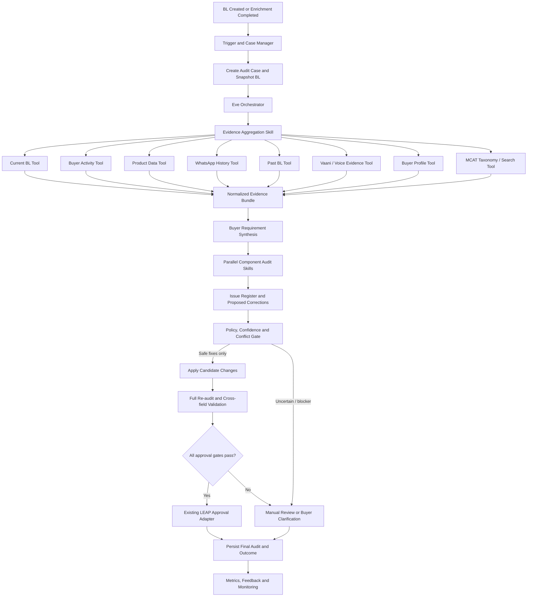
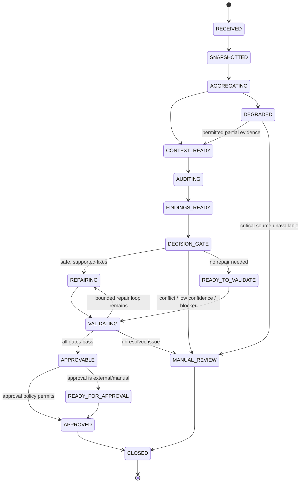
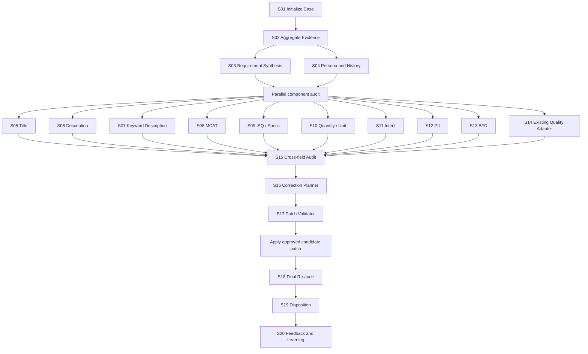
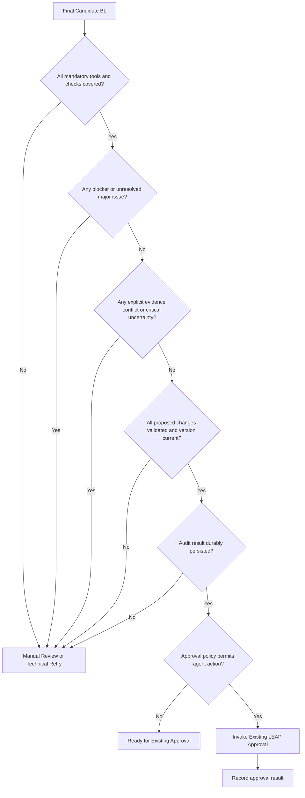

# LEAP Agentic Buyer Lead Quality & Audit System
## End-to-End Architecture and Implementation Guide
**Version:** 1.1 — Architecture proposal, current-state sections verified against code  
**Date:** 06 November 2026  
**Status:** Draft for engineering, product, data, DBA, CRM and operations review  
**Change in 1.1:** Current-state statements (sections 1.1, 1.3, 3.1, 11.2, 18, 21, 22) were checked against `leap-python/leapAi/leap-genai-api/api/bl_quality` and its Go callers in `leap-go-workers` and `leap-models-go`, and corrected where they were wrong or vague.  
**Working assumption:** “Eve” is the intended agent orchestration/runtime layer. The guide defines an Eve-independent logical architecture and an adapter boundary; confirm the exact Eve SDK, tool protocol, memory model and deployment constraints before implementation.

---

## 1. Executive summary

LEAP's current Buyer Lead (BL) pipeline enriches a lead and then approves or routes it. The existing BL Quality Agent (a LangGraph service at `POST /bl_quality` in `leap-genai-api`) runs eight rule-gated checks in parallel and returns flags plus corrected values; the Go auto-approval worker then applies those corrections and can stop auto-approval. It is a smart workflow/checking capability—not the complete agentic system envisioned here. Section 1.3 documents exactly what it does today.

The target is an **evidence-led, multi-tool, multi-skill Buyer Lead Audit Agent**. It should reconstruct the buyer's intended requirement from trusted, time-relevant evidence; inspect every material component of the current BL; correct only those fields for which a defensible correction exists; validate the complete resulting BL; and then recommend or execute an allowed disposition.

The target outcome is not merely “a lead with no flags.” It is a lead that is:
1. faithful to the buyer's actual requirement;
2. complete enough for downstream supplier discovery and fulfilment;
3. internally consistent across title, description, MCAT, specifications, quantity, units and buyer context;
4. free of detected policy, privacy and quality violations;
5. traceable to evidence, transformations, model/tool versions and approvals.

**Important:** “error-free in every case” is the product aspiration, not a guarantee that an AI system can prove. The engineering control is to prevent uncertain, conflicting, unsupported or unverified changes from being auto-approved. Such cases must be held for manual review. The system should optimize for *zero known unresolved errors at approval*, not claim zero possible errors.

### 1.1 Current state versus target state

| Dimension | Current capability (verified in code) | Target capability |
|---|---|---|
| Main job | Eight independent checks during auto-approval; the Go worker applies fixes or stops auto-approval | Understand, audit, repair, validate and disposition the entire BL |
| Quality logic | One LLM prompt per check (plus one rule-only check), each gated by a keyword/regex/word-count pre-filter; no cross-check reasoning | Reuse existing checks plus component-specific skills and cross-field reasoning |
| Context | Title, description, MCAT/category name, ISQ questions/answers, quantity/unit, buyer profile flags (company name, GST, address) and city/state, recently viewed products and prices, MCAT price Q1/median/Q3, MCAT quantity p95, probable order value, Buyer Filled Details text, and WhatsApp chat messages (only for `WHATSAPP_9696` leads, last 3 days) | Current BL + buyer activity + products + WhatsApp + past BLs + Vaani/voice evidence + buyer profile + MCAT taxonomy |
| Execution | LangGraph fan-out/fan-in, called synchronously from `LeapAutoApprovalWorker` (30 s timeout), enabled by Redis key `LLM_AGENT` | Eve-orchestrated tools and skills with explicit dependencies and gates |
| Output | 0/1 flags plus rewritten title, description and ISQ values; no confidence, no evidence references | Evidence-backed field changes, confidence, issue register, validation report and disposition |
| Safety | Redis feature flags per behaviour; before/after rows in `leap_blml_agent_audit_log`; checks fail open (an LLM or service error is treated as "no issue") | Evidence provenance, permissions, confidence thresholds, idempotency, audit trail and human review |

### 1.3 Current BL Quality Agent — verified as-built

**Where it lives**
- Python service: `leap-python/leapAi/leap-genai-api/api/bl_quality/` (`router.py` → `services.py` → `graph.py`, one file per check under `agents/`, gates in `routing.py`).
- Main caller: `leap-go-workers/.../LeapAutoApprovalWorker/leadApprovalPostgresFunc.go` (builds the payload, calls the service, applies results, writes the audit log).
- Quantity-only caller: `leap-go-workers/.../MobileVerificationQueue/MobileVerificationQueue.go` sends `enrich_qty=1`, which makes every check except absurd quantity skip.
- On-demand API: `leap-models-go/internal/api/controllers/BlQualityController.go` (`BL_QUALITY_BY_OFFER`) runs the agent for an offer ID, or runs absurd quantity alone from supplied `mcat_id` + `qty` + `qty_unit` (these flows set `skip_pov_check=1`).

**Models:** every check uses `google/gemini-3.1-flash-lite` through the LLM gateway (temperature 0, JSON output, up to 3 retries). The exception is the BFD-fill check, which uses `google/gemini-2.5-flash-lite`. Absurd quantity uses no model.

**Request → response example (abridged)**

```json
// in (built by the Go worker)
{"display_id": "1234567", "title": "Curtain", "description": "", "mcat_name": "Designer Curtains",
 "isq_asked": ["Material", "Color"], "isq_filled": ["Polyester", "Blue"],
 "quantity": 20, "quantity_unit": "Piece", "gst_flag": 0, "company_name_flag": 1, ...}

// out
{"output": {
  "one_word":   {"enriched_title": "Blue Polyester Designer Curtains", "one_word_issue": 1, "one_word_skipped": false},
  "spec_title": {"mismatch_found": 0, "spec_title_skipped": true, ...},
  "pii": {...}, "selling_intent": {...}, "absurd_quantity": {...},
  "description_correction": {...}, "bfd_fill": {...}, "buyer_filled_details": {...}}}
```

The Go worker then replaces the title, writes an audit row (`issue_flag_id=2`, `TITLE`, before `Curtain`, after the enriched title) and adds "Title Enrichment" to the lead's history comments.

**How the Go worker acts on the result (in this order)**
1. Absurd quantity = 1 and buyer country is India: delete the Quantity, Quantity Unit and order-value ISQs, then send a WhatsApp follow-up. If the message is sent, auto-approval stops.
2. Selling intent = 1: auto-approval stops ("Selling Intent Found").
3. One-word issue = 1: replace the title with the one-word result. Otherwise, if spec-title mismatch = 1, replace it with the spec-title result.
4. PII = 1: replace the title, description and ISQ answers with the cleaned versions. **Only when PII = 0** is the description-correction result applied.
5. BFD fill (Redis `FILL_BFD_ISQ=1`): every WhatsApp message judged relevant is appended as a "Buyer Filled Details" ISQ.
6. Buyer Filled Details check flags `buylead_delete` or `buyer_filled_delete`: if Redis `BFD_SEND_TO_MANUAL_POOL=1`, the lead goes to the manual pool.

**Known current-state gaps that the target design must fix**
- *Fail-open:* if an LLM call fails, most checks return "no issue". If the whole service call fails, the lead continues to approval with no checks. The target must fail closed (section 2, rule 8).
- *No cross-field reasoning:* the checks run in parallel on the same original input and never see each other's output. For example, if both the one-word check and the PII check fire, the PII `clean_title` (built from the original one-word title) overwrites the enriched title.
- *Pre-filters hide cases from the LLM:* PII runs only when a phone/email/GSTIN/card regex or the words "facebook"/"linkedin" match, so a buyer address or company name alone is never checked. Selling intent runs only on a fixed keyword list; the word "sell" alone matches "seller" and "reseller", which leaves false positives for the LLM to reject.
- *Stale comments:* the comments in `graph.py` and `absurd_quantity.py` say the absurd-quantity threshold is 10,000. The code actually runs for quantity > 1,000. Rule 3 also needs MCAT Q1 > 1,000, and rule 4 is behind Redis `IS_ABSURD_QTY_RULE4_ON`.
- *No confidence or evidence:* the outputs are binary flags and rewritten strings, so the thresholds in section 9.2 cannot be applied to the current checks without new outputs.
- *Disabled check:* a title–MCAT mismatch check (`title_mcat_mismatch`) is present but commented out of the graph.

### 1.2 Scope boundaries

**In scope**
- Data aggregation and normalization across approved LEAP/IndiaMART sources.
- Buyer intent and buyer-persona context synthesis.
- Field-level audit of title, description, MCAT, specifications, quantity/unit and relevant metadata.
- Existing quality checks and their audit compatibility.
- Evidence-backed corrections, re-validation and approval/manual-review routing.
- Explainability, monitoring, rollback and phased rollout.

**Out of scope unless separately approved**
- Replacing the complete LEAP approval platform or CRM.
- Making a supplier-selection or commercial commitment on behalf of the buyer.
- Inventing missing buyer requirements, prices, quantities, brands or technical specifications.
- Treating a model inference as buyer confirmation.
- Changing source-of-truth data or upstream systems without an approved write contract.
- Replacing AWM or other category systems wholesale. Category auditor/AuditMate responsibilities should be integrated only through an explicitly scoped interface.

---

## 2. Product principles and non-negotiable rules

1. **Buyer requirement is the source of truth.** A historical lead, profile attribute or product view is supporting context—not proof of the current requirement.
2. **Current explicit evidence outranks inferred context.** A current buyer statement or verified call transcript should normally outrank a stale profile or old BL.
3. **No unsupported completion.** A field may be enriched only when evidence supports the value and the value is relevant to this specific requirement.
4. **Preserve meaning.** Grammar, formatting and normalization may improve clarity but must not change the requested product, intent, grade, size, material, quantity, unit, location or other constraints.
5. **Separate facts from inferences.** Store observed evidence, derived interpretations and proposed corrections separately.
6. **Every write is explainable.** Record before/after values, evidence references, skill, model/prompt version, confidence, validation result and actor.
7. **Validate after repair.** A successful correction is not complete until all relevant checks are rerun against the final candidate BL.
8. **Fail closed for consequential uncertainty.** Conflicting evidence, low confidence, missing critical data, tool failure or policy ambiguity must block auto-approval.
9. **Least privilege.** Read tools are read-only by default. Write/approval tools require narrow scopes, allowlists and explicit policy gates.
10. **Idempotent processing.** Retries must not duplicate corrections, approvals, messages or side effects.
11. **Human override is first-class.** Reviewer decisions and reasons should be captured as feedback, not silently overwritten by the agent.
12. **No false certainty.** “No issue detected” means checks passed within defined coverage; it does not mean the lead is mathematically guaranteed error-free.

---

## 3. Domain model: what the agent audits

A BL should be represented as a structured, versioned object rather than a single title/description string.

### 3.1 Canonical BL components

| Component | Audit questions | Example evidence |
|---|---|---|
| Title | Is the product/service explicit, concise and faithful? Is it one-word, vague, spam-like or contradictory? | Current BL, buyer statement, past requirement |
| Description | Does it preserve use case, context, condition, quality, delivery and other stated details? | Current BL, WhatsApp, transcript |
| Search-keyword-derived description | Are any generated details actually supported by the buyer's keyword/context? | Search keyword, source evidence, enrichment trace |
| MCAT/category | Does the selected taxonomy node match the requested product and specificity? | MCAT taxonomy, category search, product evidence |
| Specifications/ISQs | Are attributes relevant, valid, complete where required, and consistent with title/description? | Buyer-filled ISQs, conversation, product context |
| Quantity | Is quantity plausible, positive, correctly parsed and paired with the correct unit? | Explicit buyer statement, current BL, historical context |
| Unit | Is the unit valid for the product and quantity? Are pack/weight/length/count semantics preserved? | Buyer statement, taxonomy/attribute definitions |
| Selling/buying intent | Is this a genuine buying requirement rather than selling, job, service request, research or unrelated intent? | Text, buyer history, conversation |
| Buyer identity/context | Is the lead correctly associated with the buyer and relevant profile? | Buyer profile, account context |
| PII/privacy | Does free text contain sensitive personal data that must be masked, removed or handled under policy? | Current BL and all text evidence |
| BFD / buyer-filled description | Is buyer-provided description present and preserved? Does it conflict with generated/enriched text? | Buyer-entered field and audit history |
| Cross-field consistency | Do title, description, MCAT, ISQs, quantity and unit describe one coherent requirement? | All above |
| Provenance/compliance | Are source, timestamp, freshness, consent/access and transformation trace available? | Tool metadata and audit log |

**Existing check registry (reconciled from code):** The verbal inventory (one-word, selling intent, absurd quantity, description, description-fill-from-search-keyword, PII, BFD, title/spec mismatch) does not map one-to-one to the code. "Description" and "description from search keyword" are **one** check. "BFD" is **two** checks. The graph runs eight checks. The Go enum `QualityAgentIssueID` defines eight IDs, and seven of them are written to the audit log.

| Graph node (`agents/*.py`) | Issue flag ID (Go) | What it does | Runs when (pre-filter) | Decided by |
|---|---|---|---|---|
| `spec_title` | 1 `QAIssueSpecMismatch` | Finds an ISQ answer that contradicts the title and replaces only the conflicting word | Title has more than one word and at least one ISQ question | LLM |
| `one_word` | 2 `QAIssueOneWordTitle` | Expands a one-word title using the ISQ answers and category | Title has exactly one word | LLM |
| `absurd_quantity` | 3 `QAIssueAbsurdQuantity` | Four rules: non-round quantity; quantity equals a viewed product price; quantity falls inside the MCAT price IQR for a buyer without GST or company name; quantity above the MCAT p95 when order value ≥ ₹10 lakh | Quantity > 1,000 | Code only |
| `pii` | 4 `QAIssuePII` | Removes phone, email, address, company name, GSTIN/PAN, card numbers or social links from the title, description and ISQ answers | Regex or keyword hit anywhere in the title, description or ISQ answers | Regex gate, then LLM |
| `selling_intent` | 5 `QAIssueSellingIntent` | Classifies the lead as selling or buying; selling stops auto-approval | Selling keyword found, unless ISQ "Usage/Application" = "Selling" | Keyword gate, then LLM |
| `description_correction` | 6 `QAIssueBuyerDescription` | Fixes spelling and removes repetition in search-keyword descriptions ("Buyer searched for …") and descriptions containing filter text | Description starts with "buyer searched for" and has more than 10 words, or contains "filter" | Code gate, then LLM |
| `buyer_filled_details` | 7 `QAIssueBuyerFilled` | Judges existing Buyer Filled Details text: `buylead_delete` (whole lead invalid) or `buyer_filled_delete` (text is useless) | Buyer Filled Details ISQ is not empty | LLM |
| `bfd_fill` | 8 `QAShouldFillBFD` (defined, never written to the audit log) | Decides which WhatsApp chat messages are relevant enough to add as Buyer Filled Details | `fill_bfd=true` (WhatsApp leads that have chat messages) | LLM |

Audit-log quirks already seen in KPI data: ID 5 rows have no attribute or values, and ID 7 rows always have empty before/after values. KPI 13 counts IDs 1, 2, 4 and 6 as corrections, and KPI 14 counts ID 3. Keep these IDs stable when the new canonical issue codes are introduced (section 3.2); add a mapping table rather than renumbering.

### 3.2 Canonical issue taxonomy

Each finding should use a stable `issue_code`, not free-form text alone.

Suggested groups:
- `TITLE_*`: one-word, vague, malformed, duplicate, unsupported claim.
- `DESCRIPTION_*`: missing, low-information, keyword-fill unsupported, contradictory, malformed.
- `MCAT_*`: missing, too broad, too narrow, wrong category, taxonomy ambiguity.
- `SPEC_*`: missing required attribute, invalid value, unsupported value, title/spec mismatch.
- `QUANTITY_*`: absurd/outlier, parse ambiguity, missing unit, unit mismatch.
- `INTENT_*`: selling intent, non-buying intent, ambiguous intent.
- `PII_*`: phone/email/address/other protected data exposure per policy.
- `BFD_*`: missing, overwritten, inconsistent or untrusted buyer-filled description.
- `CROSS_FIELD_*`: contradiction between two or more BL components.
- `EVIDENCE_*`: stale, conflicting, unavailable, insufficient or untraceable evidence.
- `SYSTEM_*`: tool timeout, schema mismatch, model failure, policy/configuration failure.

Every issue has severity (`BLOCKER`, `MAJOR`, `MINOR`, `INFO`), disposition (`AUTO_FIX`, `NEEDS_BUYER_CONFIRMATION`, `MANUAL_REVIEW`, `IGNORE_WITH_REASON`) and lifecycle (`OPEN`, `FIX_PROPOSED`, `FIXED`, `REVALIDATED`, `OVERRIDDEN`, `CLOSED`).

---

## 4. Target architecture

### 4.1 Logical layers

1. **Trigger and case manager:** Receives a BL event, creates a stable audit case and controls retries.
2. **Eve orchestration layer:** Plans and invokes skills/tools under a bounded workflow. It does not become the source of truth.
3. **Tool/data access layer:** Typed, permissioned connectors to LEAP and approved data sources.
4. **Evidence/context layer:** Normalizes source records into a time-aware evidence bundle.
5. **Skill layer:** Specialized skills for aggregation, intent, each BL component, cross-field consistency, correction and final validation.
6. **Policy and decision layer:** Applies deterministic thresholds, blockers, allowlists and routing rules.
7. **Execution adapters:** Persist approved field changes and invoke existing approval/manual-review paths.
8. **Audit/observability layer:** Stores complete lineage, metrics, traces, errors and reviewer feedback.

### 4.2 High-level system diagram



### 4.3 Orchestration state machine



**Bounded loop:** Allow at most a configured number of repair/revalidation cycles (initial recommendation: two). If a correction creates a new contradiction or the same issue recurs, stop and route to manual review. Do not let the agent loop indefinitely.

---

## 5. Tool catalogue and contracts

Tools are deterministic interfaces for retrieving or performing operations. They should not contain open-ended agent reasoning. Each tool must expose a typed schema, authorization scope, timeout, freshness metadata, error contract and audit trace.

### 5.1 Required read tools

| Tool | Purpose | Minimum input | Minimum output |
|---|---|---|---|
| `get_current_bl` | Fetch current BL and version | BL ID, case ID | Raw fields, source, version, timestamps |
| `get_buyer_activity` | Retrieve buyer interactions/activity | Buyer ID, time window, allowed activity types | Events, timestamps, activity types, product/category references |
| `get_product_context` | Retrieve product/catalog context | Product/keyword/MCAT references | Product attributes, aliases, taxonomy links, provenance |
| `get_whatsapp_history` | Retrieve authorized buyer chat context | Buyer/conversation ID, time window | Messages, sender role, timestamps, consent/access metadata |
| `get_past_buyer_leads` | Retrieve historical BLs | Buyer ID, bounded lookback, limit | Past requirement fields, dates, status, source and similarity metadata |
| `get_vaani_evidence` | Retrieve transcript/voice-agent output or recording metadata | Call/session ID or buyer ID + bounded window | Transcript segments, speaker, timestamp, confidence, recording reference/access status |
| `get_buyer_profile` | Retrieve relevant buyer profile/persona attributes | Buyer ID | Verified profile fields, freshness, source |
| `search_mcat_taxonomy` | Search the complete approved MCAT taxonomy | Query, candidate attributes, locale | Candidate MCAT IDs/names, hierarchy, descriptions, scores and taxonomy version |
| `get_attribute_definitions` | Fetch MCAT-specific ISQ definitions | MCAT ID, taxonomy version | Attribute IDs, types, units, allowed values, requiredness |
| `get_existing_quality_audit` | Read current quality checks/audit history | BL ID, BL version | Check results, issue flags, checker version and timestamps |

**Sources the current agent already reads (start the read tools from these):**

| Target tool | Existing Go function / source used today |
|---|---|
| `get_current_bl` | `inputData` (title, description, prime MCAT) + `models.MakeIsqJSON` / `GetIndustrySpecQuesDetails` for ISQs |
| `get_buyer_profile` | `GetBuyerProfileData` (company name, GST verified, address, city, state) |
| `get_buyer_activity` / `get_product_context` | `models.EnrichBuyerCard` (viewed products and prices) |
| `get_whatsapp_history` | `getBFDDetails` service (`GET_WHATSAPP_BFD_CHAT`), last 3 days, `WHATSAPP_9696` leads only |
| `search_mcat_taxonomy` (partial) | `models.FetchMcatData` (MCAT and category names), MCAT price API (`UNIT_STR` Q1/median/Q3), Redis `MCAT_QTY_STATS:<mcat_id>` (quantity p95) |
| `get_existing_quality_audit` | `leap_blml_agent_audit_log` (section 11.2) |

There is no existing source in this path for past BLs or Vaani transcripts (Vaani currently only stores a call-recording reference in Redis `VANI_MCAT_MANUAL:<offer_id>` when a lead is sent to manual review).

### 5.2 Optional but useful tools

- `get_buyer_confirmation_status`: whether an explicit confirmation was captured for a proposed field.
- `get_lead_change_history`: previous field values and actors.
- `get_employee_or_source_metadata`: trusted source/creator metadata needed for policy.
- `get_unit_dictionary`: canonical units and conversion rules.
- `get_policy_configuration`: active thresholds, restricted data rules and approval policies.
- `get_manual_review_context`: existing review queue and reviewer notes.

### 5.3 Write/action tools (strictly gated)

| Tool | Allowed purpose | Guardrail |
|---|---|---|
| `propose_bl_patch` | Store a candidate patch, not publish it | Must include field-level evidence and expected BL version |
| `apply_bl_patch` | Persist approved safe corrections | Compare-and-swap version check; allowlisted fields; idempotency key |
| `send_buyer_clarification` | Ask buyer to resolve a material ambiguity | Approved templates, rate limits, consent and channel policy |
| `route_manual_review` | Place case in correct review pool | Include reason codes and evidence summary |
| `invoke_existing_approval` | Call current LEAP approval mechanism | Only after all gates pass; no duplicate approval |
| `write_audit_result` | Persist final audit and lineage | Append-only or immutable event history |

Do not give the general orchestrator unrestricted database access. Tools should call approved APIs/services; direct SQL writes from model-generated plans are prohibited.

### 5.4 Tool contract envelope

Every tool response should carry a common envelope:

```json
{
  "tool_name": "get_whatsapp_history",
  "request_id": "uuid",
  "case_id": "stable-audit-case-id",
  "subject_id": "buyer-or-bl-id",
  "status": "SUCCESS",
  "source_system": "approved-source",
  "retrieved_at": "2026-11-06T08:30:00Z",
  "data_as_of": "2026-11-06T08:25:00Z",
  "freshness_seconds": 300,
  "schema_version": "1.0",
  "records": [],
  "warnings": [],
  "error": null,
  "access_policy": {
    "authorized": true,
    "purpose": "buyer-lead-quality-audit"
  }
}
```

Use explicit statuses such as `SUCCESS`, `PARTIAL`, `NOT_FOUND`, `STALE`, `DENIED`, `TIMEOUT`, `SCHEMA_ERROR`, `ERROR`. Empty results must not be confused with tool failure.

### 5.5 Source precedence and freshness

Suggested default precedence, subject to business/legal sign-off:

1. Current explicit buyer statement for this requirement.
2. Current buyer-confirmed WhatsApp/call transcript evidence.
3. Current BL buyer-entered fields.
4. Recent relevant buyer activity and product context.
5. Past BLs for the same product/requirement.
6. Verified buyer profile.
7. General catalog/taxonomy context.

This is not a universal ranking. For example, the current BL may be the authoritative record of a field the buyer explicitly entered, while a transcript may be authoritative for a later correction. Resolve conflicts by timestamp, speaker identity, explicitness and source reliability. Never let a generic profile preference overwrite a current explicit requirement.

Define source-specific TTLs. Example starting policy (tune with data owners):
- Current BL snapshot: immutable for the case; refresh if version changes.
- WhatsApp/call transcript: use only the relevant conversation window; preserve message/call timestamps.
- Activity: recent window configurable by signal type; do not infer intent from a single click.
- Past BLs: bounded lookback and similarity threshold; stale history is weak evidence.
- Buyer profile: use verified/fresh attributes only; mark stale attributes.
- Taxonomy: pin a taxonomy version for the case and record it.

---

## 6. Evidence model and buyer requirement synthesis

### 6.1 Evidence is not the same as a field value

Normalize evidence into records such as:

```json
{
  "evidence_id": "ev-uuid",
  "case_id": "case-uuid",
  "subject": "buyer_requirement",
  "field_hint": "quantity",
  "value_text": "500 kg",
  "normalized_value": {"amount": 500, "unit": "kg"},
  "source_type": "WHATSAPP",
  "source_ref": "conversation/message reference",
  "speaker": "BUYER",
  "observed_at": "2026-11-06T08:12:00Z",
  "retrieved_at": "2026-11-06T08:14:00Z",
  "explicitness": "EXPLICIT",
  "reliability": 0.98,
  "freshness": "CURRENT",
  "consent_scope": "approved-purpose",
  "redaction_status": "APPLIED"
}
```

The confidence/reliability fields are estimates, not proof. Keep original text or a protected reference as permitted by retention policy. Minimize copied PII.

### 6.2 Requirement representation

Create a canonical `BuyerRequirement` object:

- `product_or_service`: buyer's requested item/service.
- `intended_use`: only if stated or strongly supported.
- `attributes`: key/value/unit plus evidence links.
- `quantity`: numeric value, unit and parsing confidence.
- `quality_grade/specification`: explicit buyer requirement.
- `brand/model`: only when explicitly stated or confirmed.
- `delivery_location/timeline`: only when present and policy permits.
- `buying_intent`: buying/selling/other/ambiguous with rationale.
- `constraints`: exclusions and preferences stated by buyer.
- `open_questions`: missing/conflicting information that matters.
- `evidence_map`: field-to-evidence references.
- `synthesis_confidence`: per field and overall.

Do not fill a missing value from a typical market convention and present it as buyer intent.

### 6.3 Buyer persona

Persona should be a **bounded operational summary**, not a demographic guess. It may include verified business category, past product interests, buying frequency, stated preferences and interaction context. It must not infer sensitive traits or use irrelevant personal characteristics.

Persona is contextual evidence only. It must not override explicit current requirements. Store the source and timestamp for every persona attribute.

### 6.4 Activity interpretation

Buyer activity signals can be noisy. Define event semantics:
- Product viewed is not equivalent to product requested.
- Repeated views can increase relevance but do not establish quantity or buying intent.
- Search keyword is a clue, not permission to invent a description.
- A historical BL is not automatically the current requirement.
- Activity from another user/account must not be attributed to the buyer without verified identity linkage.

---

## 7. Skill catalogue

A skill is a bounded unit of domain work with defined inputs, outputs, dependencies, failure behavior and test cases. Skills should return structured results—not directly approve a BL.

### 7.1 Core orchestration skills

**S01 — Case initialization and BL snapshot**
- Input: BL ID, trigger event.
- Work: create stable case ID, fetch BL, record version, deduplicate event.
- Output: immutable case snapshot and processing state.
- Failure: stop if BL identity/version cannot be established.

**S02 — Evidence aggregation and source validation**
- Work: call permitted read tools in parallel where independent; normalize results; validate schema, freshness, source and access; deduplicate evidence.
- Output: evidence bundle with source coverage matrix and warnings.
- Failure: partial data is allowed only when the missing source is non-critical under policy.

**S03 — Buyer requirement synthesis**
- Work: infer a structured requirement from explicit evidence; resolve chronology; identify conflicts and open questions.
- Output: `BuyerRequirement`, per-field confidence and evidence map.
- Failure: ambiguous product/quantity/specification becomes a review/clarification condition.

**S04 — Buyer persona and history context**
- Work: summarize only relevant, verified profile/history signals.
- Output: operational context with freshness and evidence references.
- Failure: omit unsupported/stale fields; do not fabricate persona details.

### 7.2 Component audit skills

Each component skill must assess the **current value**, compare it to the canonical requirement and supporting evidence, produce findings, and optionally propose a correction.

**S05 — Title audit**
- Product identity, specificity, clarity, one-word title, malformed text, unsupported attributes and duplication.
- Output: title score, issue codes, proposed title and evidence.

**S06 — Description audit**
- Completeness, readability, relevant context, contradictions, unsupported additions and preservation of buyer meaning.
- Separate buyer-authored description from generated/enriched description.

**S07 — Search-keyword description enrichment audit**
- Verify that every generated phrase is supported by the search keyword or stronger evidence.
- Reject keyword stuffing, unrelated catalog copy and invented attributes.
- Preserve provenance at phrase/sentence level where feasible.

**S08 — MCAT/category audit**
- Search taxonomy; compare candidate hierarchy and product semantics; evaluate specificity and ambiguity.
- Return ranked candidate IDs, taxonomy version, rationale and confidence.
- Do not auto-change MCAT when close candidates are semantically indistinguishable or downstream impact is high.

**S09 — ISQ/specification audit**
- Validate attribute relevance, data type, allowed values, unit, requiredness and cross-field consistency.
- Distinguish buyer-provided specs from catalog-derived suggestions.
- Do not fill a required spec unless evidence supports it or the value is deterministically derivable.

**S10 — Quantity and unit audit**
- Parse numeric expressions and units; detect zero/negative, implausible outliers, parse ambiguity and mismatch.
- Use product-specific statistical baselines only as anomaly signals—not as grounds to rewrite quantity.
- Never silently convert pack size, weight, area, length or count semantics.

**S11 — Buying/selling intent audit**
- Classify buying, selling, service/job/other or ambiguous.
- Use text and corroborating context; avoid treating a single activity event as intent.
- Return reason spans/evidence and confidence.

**S12 — PII/privacy audit**
- Detect relevant PII in title, description, specs and imported text.
- Apply policy-defined masking/removal or route for review.
- Preserve required business contact fields only where explicitly allowed by product policy; do not delete legitimate fields indiscriminately.

**S13 — BFD / buyer-authored content integrity audit**
- Identify buyer-filled content and protect it from unsupported overwrite.
- Compare buyer-authored and generated content; preserve source distinction.
- Flag material contradictions and missing buyer context.

**S14 — Existing BL Quality Agent adapter**
- Invoke/reuse existing checks and translate outputs into the canonical issue schema.
- Retain existing checker version and original flag IDs.
- Avoid duplicating checks with new skills until equivalence is demonstrated.
- Reconcile deployed check inventory and issue IDs in Phase 0.

**S15 — Cross-field consistency audit**
- Check title ↔ description ↔ MCAT ↔ ISQs ↔ quantity/unit ↔ intent.
- Detect contradictory product identity, grade, size, model, material or use.
- Produce a consistency graph and blockers.

### 7.3 Repair and validation skills

**S16 — Correction planner**
- Rank proposed fixes by evidence strength, impact and reversibility.
- Generate field-level patch candidates with old/new values, evidence IDs, reason, confidence and risk.
- Mark each as safe auto-fix, confirmation-required or manual-only.

**S17 — Patch validator**
- Validate schema, allowed values, taxonomy version, field dependencies and semantic preservation.
- Reject patches that add unsupported facts or alter explicit buyer constraints.

**S18 — Final BL auditor**
- Rerun all applicable checks against the candidate final BL.
- Confirm no unresolved blocker/major issue, no newly introduced contradiction and all required provenance is present.

**S19 — Disposition and routing**
- Apply deterministic policy to decide approve, ready-for-existing-approval, manual review, buyer clarification or technical retry.
- The skill returns a recommendation; the policy/approval adapter controls the actual action.

**S20 — Feedback and learning capture**
- Capture reviewer override, buyer correction and downstream quality outcome.
- Label outcomes for offline evaluation; do not let online feedback silently change production prompts/models.

---

## 8. Skill dependency and execution plan



### 8.1 Parallelism rules

Can run in parallel after evidence is ready:
- Title, description, keyword-description, MCAT, ISQ, quantity, intent, PII, BFD and existing quality checks.
- Independent read tools after case initialization.

Must be sequential:
- Evidence validation before requirement synthesis.
- Requirement synthesis before final component comparisons.
- Correction planning after findings are available.
- Patch validation before writes.
- Full re-audit after writes.
- Disposition after final audit.

### 8.2 Skill interface standard

Each skill should accept:
- `case_id`, `bl_id`, `bl_version`;
- normalized current BL;
- only the relevant evidence bundle subset;
- taxonomy/policy/check-registry versions;
- skill/model/prompt version;
- deadline and token/tool budget.

Each skill returns:
- `status`: success/partial/failed/not_applicable;
- `findings[]`: issue code, severity, field, explanation, evidence IDs;
- `proposals[]`: before/after, confidence, evidence IDs, risk, fix class;
- `coverage`: fields and checks actually evaluated;
- `warnings[]`, `errors[]`;
- `trace_id`, version metadata.

---

## 9. Correction policy: what the agent may and may not fix

### 9.1 Proposed correction classes

| Class | Examples | Default action |
|---|---|---|
| Deterministic normalization | Whitespace, safe casing, duplicate spaces, approved unit formatting | Auto-fix if meaning unchanged |
| Evidence-backed rewrite | Clear typo/grammar; title wording directly supported by buyer statement | Auto-fix only above strict threshold and after semantic validation |
| Taxonomy correction | MCAT clearly wrong with strong unique candidate | Candidate patch; initially manual approval |
| Missing requirement | Missing grade, quantity, size, brand or critical spec | Ask buyer or manual review; never invent |
| Conflicting evidence | WhatsApp says one size, call says another | Manual review/clarification |
| Policy/privacy issue | PII or restricted content | Policy-specific handling; review if uncertain |
| Statistical anomaly | Quantity far outside distribution | Flag/confirm; do not replace with “normal” quantity |

### 9.2 Example confidence policy (initial proposal)

Thresholds must be calibrated on a labeled dataset, not accepted as universal truths.

- `>= 0.98`: deterministic formatting-only fixes may be eligible for auto-apply.
- `0.95–0.979`: evidence-backed low-risk text corrections may be eligible after strict validation and rollout approval.
- `0.80–0.949`: propose for human review; do not auto-apply consequential changes.
- `< 0.80`: no correction; manual review or buyer clarification.
- Any conflicting explicit evidence, missing critical provenance, tool failure on a required source, policy blocker or low-reliability speaker identity overrides numeric confidence and blocks auto-approval.

Use per-field calibrated confidence, not one overall model score. A model's self-reported confidence is not calibration.

### 9.3 Semantic preservation checks

For every proposed patch:
- Compare extracted product identity before/after.
- Compare explicit attributes, values and units.
- Compare quantity and unit.
- Compare negations, exclusions and conditional terms.
- Compare brand/model/grade/size/material.
- Confirm no new facts were added without evidence.
- Confirm buyer-authored content was not overwritten.
- Keep an evidence-to-change mapping for every material token/field.

---

## 10. Decision engine and approval gates

The decision must be deterministic and policy-driven after the agent skills finish.

### 10.1 Suggested dispositions

1. `AUTO_APPROVE`: all mandatory tools/checks covered, no blockers/major unresolved issues, all changes safe and validated, version unchanged, policy allows automatic approval.
2. `READY_FOR_EXISTING_APPROVAL`: audit passed but existing LEAP approval authority remains the final actor.
3. `MANUAL_REVIEW`: conflicting evidence, uncertain MCAT, consequential unsupported field, major issue, low confidence or policy ambiguity.
4. `BUYER_CLARIFICATION`: a specific missing/conflicting requirement can be resolved by asking the buyer.
5. `TECHNICAL_RETRY`: transient failure; retry safely with bounded backoff and idempotency.
6. `REJECT_OR_NON_BUYING_ROUTE`: only when existing business policy explicitly supports this disposition and evidence is sufficient.

### 10.2 Hard blockers

Auto-approval must be blocked when any of these apply:
- Current BL version changed after snapshot and has not been re-audited.
- Critical evidence source is unavailable or unauthorized.
- Buyer identity or source attribution is uncertain.
- Material explicit evidence conflicts.
- Product identity or buying intent is ambiguous.
- MCAT is unresolved where MCAT is mandatory.
- Required specs/quantity/unit are missing or contradictory under the relevant policy.
- PII/policy issue is unresolved.
- Existing quality check failed or could not run where mandatory.
- Repair patch failed validation or re-audit.
- Any `BLOCKER` or unresolved `MAJOR` finding remains.
- Audit record cannot be durably written.

### 10.3 Approval sequence



Do not treat an agent response such as “looks good” as an approval authorization.

---

## 11. Data architecture and persistence

### 11.1 Suggested logical entities

| Entity | Purpose | Key fields |
|---|---|---|
| `bl_audit_case` | One audit lifecycle per BL version/trigger | case_id, bl_id, source_version, status, created_at |
| `bl_audit_snapshot` | Immutable input snapshot | case_id, field payload, schema_version, hash |
| `bl_evidence` | Normalized source evidence | evidence_id, case_id, source, source_ref, observed_at, field_hint |
| `bl_requirement_snapshot` | Synthesized buyer requirement | case_id, requirement JSON, confidence, evidence map |
| `bl_skill_execution` | Skill run metadata | run_id, skill_id, version, status, latency, trace_id |
| `bl_audit_finding` | Canonical issue registry | finding_id, case_id, issue_code, severity, field, lifecycle |
| `bl_patch_proposal` | Proposed correction | patch_id, field, before, after, evidence_ids, confidence |
| `bl_patch_event` | Applied/rolled-back changes | patch_id, actor, version_before/after, timestamp |
| `bl_final_validation` | Re-audit results | case_id, coverage, pass/fail, unresolved_issues |
| `bl_audit_decision` | Final disposition | case_id, decision, reason_codes, policy_version |
| `bl_audit_feedback` | Reviewer/buyer feedback | case_id, outcome, corrected_value, reviewer_reason |
| `bl_tool_call_log` | Tool lineage and operational debugging | tool, request_id, status, latency, source version |

These are logical entities, not a mandate to create one physical table per entity. Review data ownership, volume, retention, indexing, PII and existing audit infrastructure with DBA/data platform teams before choosing storage.

### 11.2 Existing audit integration

The existing audit surface is the Postgres table `leap_blml_agent_audit_log`, (the `postgreML` connection). Reporting reads its lakehouse/BigQuery copy `leapml.leap_blml_agent_audit_log` (KPI 13/14); confirm the sync lag with the data team. The Go workers write one row per applied change:

| Column | Content |
|---|---|
| `fk_eto_ofr_id`, `fk_glusr_id` | BL display ID and buyer ID |
| `offer_approve_date` | `NOW()` at insert time, not the actual approval time |
| `issue_flag_id` | 1–7 from `QualityAgentIssueID` (section 3.1) |
| `attribute_name` | `TITLE`, `DESCRIPTION`, `ISQ`, `QUANTITY`, `ORDER_VALUE`, `BUYLEAD_DELETE`, `BUYER_FILLED_DELETE` or empty; truncated to 50 characters |
| `attribute_value_before_approval` / `_after_approval` | Old and new values, truncated to 500 characters |

Limits that matter for the new design: there is no case ID, version, evidence, model/prompt version, confidence or reviewer outcome. Values are truncated. Rows are written before the BL update is committed, so a rolled-back change still leaves a row. It cannot store the agent evidence graph. Keep it as-is for KPI compatibility, write the new lineage entities (section 11.1) separately, and link them by BL ID and `issue_flag_id`. Do not repurpose existing columns without schema/owner approval.

### 11.3 Data lineage requirements

For each final field value, be able to answer:
- What was the original value?
- What is the final value?
- Who/what changed it and when?
- Which evidence supports it?
- Which skill/tool/model/prompt version proposed it?
- Which policy and taxonomy versions were used?
- Which validations passed?
- Was a human involved?
- Can the change be rolled back?

### 11.4 Retention and privacy

- Store only data needed for the audit purpose.
- Avoid copying full WhatsApp histories or audio when a protected source reference and relevant transcript excerpt suffice.
- Define retention by source and legal/policy requirements.
- Redact PII from model context where not necessary.
- Enforce tenant/buyer-level authorization and access logging.
- Never train on private buyer conversations by default; follow company-approved data governance.
- Keep secrets, tokens and credentials out of prompts, logs and audit payloads.

---

## 12. Eve implementation design

The logical design should map to Eve's actual capabilities only after reviewing its runtime documentation and constraints.

### 12.1 Eve responsibilities

- Maintain the case execution state.
- Select only registered skills allowed for the current state.
- Invoke tools through typed adapters.
- Pass bounded evidence subsets to skills.
- Enforce dependency ordering and execution budgets.
- Aggregate structured outputs.
- Stop on blockers, permission errors or repeated failures.
- Call deterministic policy gates before any write/approval.
- Emit trace IDs and structured events.

### 12.2 What Eve must not do

- Bypass the policy engine.
- Make direct unrestricted DB writes.
- Treat tool output or retrieved text as executable instructions.
- Allow buyer chat content to alter system instructions or tool permissions.
- invent missing requirement values.
- Approve a BL based solely on its own narrative.
- Retry non-idempotent side effects blindly.
- use unbounded agent-to-agent delegation or unlimited repair loops.

### 12.3 Prompt and instruction separation

Keep separate:
1. System policy: role, allowed actions, privacy, safety and non-negotiable constraints.
2. Skill contract: one task, input/output schema, failure behavior.
3. Evidence: untrusted data with source and timestamps.
4. Runtime policy: budgets, timeouts, retries, model choice and thresholds.
5. Decision policy: deterministic approval gates.

Treat WhatsApp, transcripts, descriptions and external catalog text as **untrusted data**. Prompt injection embedded in those sources must never be followed as instructions.

### 12.4 Model strategy

Use deterministic code for:
- schema validation, unit parsing where rules are deterministic, allowlists, version checks, deduplication, threshold gates and idempotency.

Use models for:
- semantic classification, requirement synthesis, language normalization, ambiguity detection and cross-field comparison.

Use retrieval/search for:
- taxonomy and product candidates.

Do not use a single large model call to do all work. Select the smallest model that meets measured accuracy for each skill; use a stronger model or human review for ambiguous/high-impact cases. Record model/version per execution.

---

## 13. End-to-end runtime sequence

1. **Trigger:** BL created/enrichment completed; event includes BL ID and version.
2. **Deduplicate:** case manager checks idempotency key; existing in-flight/completed case is reused or safely reopened by policy.
3. **Snapshot:** fetch current BL and store immutable snapshot/hash.
4. **Aggregate:** call required read tools in parallel with bounded timeouts.
5. **Validate evidence:** check schema, authorization, timestamps, source reliability and freshness.
6. **Synthesize requirement:** construct structured requirement with evidence map and conflicts.
7. **Run audits:** component skills and existing Quality Agent adapter execute.
8. **Normalize findings:** map results to canonical issue taxonomy and severity.
9. **Cross-field audit:** detect inconsistencies across all BL components.
10. **Plan fixes:** generate field-level patches only where evidence supports them.
11. **Policy gate:** decide which patches are safe, which require confirmation and which block approval.
12. **Apply candidate patch:** compare-and-swap against source BL version; use idempotency key.
13. **Re-audit:** rerun impacted checks and all final mandatory checks.
14. **Final decision:** deterministic approval gate evaluates coverage, blockers, conflicts, version and audit persistence.
15. **Disposition:** call existing LEAP approval path or manual review/clarification route.
16. **Persist:** write immutable decision, evidence references, patches and trace.
17. **Observe:** publish metrics and reviewer feedback; alert on regressions.

---

## 14. Failure handling and resilience

| Failure | Required behavior |
|---|---|
| Buyer activity unavailable | Mark source unavailable; continue only if policy says non-critical; record coverage gap |
| WhatsApp/voice access denied | Do not bypass; proceed only under approved partial-evidence policy, otherwise manual review |
| Transcript missing/low quality | Do not infer words; mark evidence insufficient |
| MCAT taxonomy unavailable | No taxonomy correction; block if MCAT validation is mandatory |
| Model timeout | Bounded retry; then technical retry/manual review |
| Tool schema drift | Fail closed for dependent skill; alert owner; do not parse guessed fields |
| BL version changed | Abort patch; fetch new snapshot and restart audit |
| Patch partially applied | Reconcile using patch ID/version; never blindly replay |
| Audit persistence failure | Do not approve; retry durable write then route technical failure |
| Duplicate event | Return existing case outcome; no duplicate write/approval |
| Contradictory evidence | Preserve both sources and timestamps; route to clarification/review |
| Prompt injection in source text | Treat as data; ignore instructions; log security signal |

Retries should use exponential backoff with jitter for transient failures, bounded attempts, circuit breakers and dead-letter handling. Do not retry authorization denial or schema mismatch as if transient.

---

## 15. Security, privacy and governance

- Service-to-service identity; no shared personal credentials.
- Separate read scopes and write scopes.
- Per-tool allowlists and field-level write restrictions.
- Encryption in transit and at rest.
- Secret management outside code/prompts.
- Access logs for buyer activity, messages, transcripts and profile.
- PII redaction before model calls where possible.
- Data minimization and retention schedules.
- Explicit purpose limitation for conversation/recording access.
- Review consent, recording, messaging and retention rules with legal/compliance.
- Prompt-injection defenses and untrusted-content isolation.
- Human review for high-impact or ambiguous decisions.
- Change control for prompts, models, thresholds, taxonomy and policies.
- Incident response and rollback plan.
- Separate development/staging/production data and credentials.

---

## 16. Evaluation strategy and success metrics

Do not launch based only on aggregate accuracy. Evaluate by field, issue type, source coverage, buyer segment and BL origin.

### 16.1 Offline evaluation dataset

Build a human-reviewed gold set containing:
- clean BLs;
- each known issue type;
- multi-issue BLs;
- conflicting WhatsApp/call/history evidence;
- ambiguous product names and MCAT candidates;
- unusual but legitimate quantities;
- non-buying/selling intent;
- PII edge cases;
- sparse evidence and tool failures;
- buyer-authored versus generated description conflicts.

Use time-based splits to avoid leakage. Have at least two reviewers for high-impact labels and adjudicate disagreements. Keep a frozen regression set.

### 16.2 Core metrics

| Metric | Definition |
|---|---|
| Critical error escape rate | Known critical errors among auto-approved BLs / auto-approved BLs |
| False auto-fix rate | Incorrect material changes / all material auto-fixes |
| Field-level precision/recall | Per component and issue code |
| Requirement fidelity | Human score for whether final BL reflects buyer's actual requirement |
| MCAT accuracy | Correct MCAT among reviewed decisions |
| Unsupported enrichment rate | Added facts without supporting evidence |
| Rework rate | Approved BLs later corrected/rejected for quality reasons |
| Manual review rate | Cases routed to human review / all audited cases |
| Buyer clarification rate | Cases requiring buyer response |
| Tool coverage | Required sources successfully retrieved / required sources |
| End-to-end latency | Trigger-to-disposition p50/p95 |
| Cost per audited BL | Model + tool + infrastructure cost |
| Duplicate side-effect rate | Duplicate patch/approval/message count |
| Reviewer override rate | Human changes to agent decision or patch |

### 16.3 Launch gates (proposed)

Set numerical gates only after baseline measurement and business sign-off. At minimum:
- No known critical safety/privacy issue in the frozen evaluation set.
- No unsupported material auto-fix in the approved auto-fix cohort.
- High precision on auto-approval eligibility, even if recall is initially lower.
- Stable performance across source-missing and low-volume categories.
- Full audit lineage for every pilot case.
- No duplicate approvals under retry/replay tests.
- Rollback and kill switch tested.
- Manual review capacity confirmed.

---

## 17. Testing plan

### 17.1 Unit tests
- Each parser, validator, issue mapper and policy rule.
- Quantity/unit edge cases and locale formats.
- MCAT taxonomy hierarchy and attribute constraints.
- PII masking and false-positive handling.
- Patch semantic preservation.

### 17.2 Contract tests
- Every tool schema and error status.
- API auth/permission boundaries.
- Version and freshness metadata.
- Taxonomy version compatibility.
- Existing Quality Agent output-to-canonical mapping.

### 17.3 Integration tests
- Full tool aggregation with partial failures.
- Parallel skill execution and timeout behavior.
- Candidate patch + compare-and-swap.
- Re-audit after patch.
- Existing LEAP approval and manual review adapters.

### 17.4 End-to-end scenario tests
1. Clean BL: no changes; pass and route.
2. One-word title with clear evidence: safe correction and re-audit.
3. Selling intent: block buying-lead approval.
4. Absurd-looking but buyer-confirmed quantity: do not “correct” it; confirm/review according to policy.
5. Missing description: do not invent details.
6. Keyword enrichment introduces unsupported product attribute: reject generated text.
7. PII in free text: policy handling and audit.
8. Title and ISQ mismatch: identify contradiction; repair only if evidence resolves it.
9. Two MCAT candidates close in meaning: manual review.
10. WhatsApp and call transcript conflict: clarification/review.
11. Past BL differs from current BL: current explicit requirement wins.
12. Required tool timeout: safe degraded path or hold.
13. BL updated mid-audit: version conflict and restart.
14. Duplicate event/retry: exactly-once logical side effects.
15. Prompt injection in buyer message: no instruction execution.
16. Audit store unavailable: no approval.
17. Human reviewer rejects patch: preserve override and feedback.
18. PII or source access denied: enforce permissions and do not retry around denial.

---

## 18. Rollout roadmap

### Phase 0 — Discovery and inventory (1–2 weeks; estimate)
- Confirm Eve platform/runtime and deployment constraints.
- Map current BL lifecycle and approval entry points.
- Confirm the check registry in section 3.1 against production config. The code has been reconciled; still confirm which Redis flags (`LLM_AGENT`, `LLM_AGENT_NEW`, `FILL_BFD_ISQ`, `BFD_SEND_TO_MANUAL_POOL`, `IS_ABSURD_QTY_RULE4_ON`, `QA_COMMENTS_TAGGING`) are on in production.
- Decide how the current fail-open behaviour and parallel-overwrite issue (section 1.3) are handled during the transition.
- Inventory source systems, owners, APIs, access scopes, data quality and latency.
- Define buyer requirement schema, issue taxonomy and policy owners.
- Establish baseline KPIs and labeled evaluation data.
**Exit:** signed architecture, data-source matrix, check registry, policy matrix and pilot scope.

### Phase 1 — Read-only evidence foundation (2–3 weeks; estimate)
- Build case manager, snapshot and idempotency.
- Build typed read-only tools.
- Build evidence normalization and source coverage.
- Add traces, audit events and access controls.
- No field writes and no automatic approval.
**Exit:** reliable, replayable evidence bundle for pilot BLs.

### Phase 2 — Skills and shadow audit (2–4 weeks; estimate)
- Implement requirement synthesis and component skills.
- Integrate existing Quality Agent as an adapter.
- Implement cross-field consistency and canonical issue mapping.
- Run in shadow mode; compare with reviewers and existing outcomes.
**Exit:** measured precision/recall and acceptable source coverage.

### Phase 3 — Suggest-only correction (2–3 weeks; estimate)
- Implement correction planner, patch schema and semantic validator.
- Show proposed changes with evidence to reviewers.
- Capture accept/reject/edited feedback.
- No automatic material writes.
**Exit:** high acceptance and low false-fix rate on eligible classes.

### Phase 4 — Limited auto-fix pilot (2–4 weeks; estimate)
- Enable only deterministic, low-risk, reversible fixes.
- Apply compare-and-swap and re-audit.
- Keep manual review for MCAT and consequential requirement fields initially.
- Use allowlisted traffic/cohort and kill switch.
**Exit:** no critical escapes, no duplicate side effects, stable operational metrics.

### Phase 5 — Controlled disposition automation
- Expand auto-fix classes only with evidence.
- Integrate final policy gate with existing approval path.
- Increase cohort gradually.
- Add reviewer feedback and drift monitoring.
**Exit:** signed production readiness and operational ownership.

**Estimates are planning ranges, not commitments.** Actual timing depends on API readiness, data permissions, Eve capabilities, review capacity and quality of the source data.

---

## 19. Team ownership and dependencies

| Workstream | Accountable partner | Deliverables |
|---|---|---|
| Product/LEAP | LEAP product + engineering | Scope, workflow, acceptance criteria, approval rules |
| Eve/orchestration | Agent platform owner | Runtime, skill registration, orchestration, tracing |
| Source integrations | Owning teams for each system | APIs, auth, schemas, SLAs and data definitions |
| DBA/data platform | DBA + data engineering | Read access, storage, indexing, retention and audit |
| Taxonomy/MCAT | Category/taxonomy owners | Full taxonomy, IDs, attributes, versioning and search |
| WhatsApp/voice | Messaging and Vaani owners | Authorized conversation/transcript access and metadata |
| Security/privacy | Security + legal/compliance | Purpose, access, PII, retention and consent rules |
| QA/operations | QA + BL reviewers | Gold dataset, manual review SOP, regression and monitoring |
| SRE/platform | DevOps/SRE | Deployment, secrets, dashboards, alerts, rollback |

No source should be integrated based solely on a team name or assumed table. Confirm owner, contract, data meaning and access path.

---

## 20. Operational dashboards and alerts

Dashboard slices:
- Total cases by status/disposition.
- Auto-approval versus manual review.
- Issue counts by component and severity.
- Fix proposals, accepted fixes, rejected fixes and rollback.
- Source availability/freshness by tool.
- Skill success rate, latency and token/tool cost.
- Re-audit failures and repair-loop count.
- Reviewer override and buyer clarification rates.
- Critical error escapes and post-approval rework.

Alert on:
- Critical error escape.
- Sudden auto-approval increase or manual-review collapse.
- Tool authorization failures or schema drift.
- Source freshness/coverage degradation.
- Model/skill error or latency spike.
- Patch conflict/duplicate side effects.
- Audit persistence failure.
- Taxonomy version mismatch.
- PII detection regression.

---

## 21. Open decisions that must be resolved before production

1. What exact Eve runtime/version is used, and what are its tool, skill, state, memory and deployment contracts?
2. ~~What is the exact deployed list of existing BL Quality Agent checks?~~ Answered from code in section 3.1. Still open: which Redis feature flags are on in production, and whether the disabled title–MCAT mismatch check should return.
3. Which sources are mandatory for all BLs versus conditional by BL type?
4. What are the approved APIs and owners for buyer activity, product data, WhatsApp, past BLs, Vaani/voice and buyer profile?
5. What is the source precedence when buyer-entered BL, WhatsApp and voice evidence conflict?
6. Which fields can be auto-corrected, and which always require buyer confirmation or manual review?
7. Is the agent allowed to invoke final approval, or only prepare a “ready for existing approval” result?
8. What are the current MCAT taxonomy source, update cadence, search API and attribute-definition contract?
9. What are the PII policy, consent basis, recording access rules and retention requirements?
10. Where should full evidence lineage live, and what can the existing audit table support?
11. What are expected daily volume, peak concurrency, latency SLO and per-BL cost ceiling?
12. What pilot cohort, rollback owner and manual review capacity are available?

---

## 22. Recommended first engineering backlog

| Priority | Epic / story | Definition of done |
|---|---|---|
| P0 | Current-state BL Quality Agent audit | Code-level inventory done (sections 1.3, 3.1, 11.2); remaining work is to confirm production Redis flags and baseline each check's precision from audit-log data |
| P0 | Eve capability spike | Tool/skill/state/trace/security integration proven in a sandbox |
| P0 | Canonical BL + requirement schema | Versioned schema reviewed by LEAP and data owners |
| P0 | Source/API inventory | Owner, endpoint, fields, auth, freshness, SLA and failure behavior documented |
| P0 | Policy and decision matrix | Auto-fix, blocker, manual and clarification rules signed off |
| P1 | Case manager and snapshot | Idempotent case lifecycle and version conflict handling |
| P1 | Read-only tool adapters | Typed, permissioned, observable connectors |
| P1 | Evidence normalization | Provenance, timestamps, freshness and source coverage |
| P1 | Existing Quality Agent adapter | Existing checks represented in canonical schema without behavior regression |
| P1 | Requirement synthesis skill | Evidence-backed requirement and conflict list |
| P1 | Component audit skills | Structured issue and proposal outputs |
| P1 | Cross-field audit | Contradictions and dependencies evaluated |
| P2 | Correction planner and validator | Evidence-linked candidate patches and semantic preservation |
| P2 | Final re-audit | Full validation after candidate changes |
| P2 | Manual review adapter | Reasons, evidence and reviewer feedback visible |
| P3 | Limited patch writer | Allowlisted, idempotent, compare-and-swap writes |
| P3 | Approval adapter | Existing approval invoked only after hard gates |
| P3 | Dashboards and alerts | Operational and quality metrics available |
| P3 | Pilot and rollback | Cohort control, kill switch, replay and rollback tested |

---

## 23. Definition of done for the agentic system

The system is ready for a controlled production pilot only when:

- Every audited BL has a stable case ID and immutable input snapshot.
- All configured tools have typed contracts, owners, permissions and failure behavior.
- Evidence is timestamped, source-linked and freshness-aware.
- Requirement synthesis separates explicit facts, inference and unknowns.
- Every BL component has an audit skill or an explicitly documented not-applicable rule.
- Existing BL Quality Agent checks are integrated and their flag mapping is verified.
- Cross-field consistency is evaluated.
- Every proposed correction has evidence, confidence, risk and before/after values.
- Unsupported material changes are blocked.
- Every applied patch is version-checked, idempotent and re-audited.
- Manual review and buyer clarification paths work.
- Approval gates are deterministic and fail closed.
- Complete lineage is persisted before approval.
- Security/privacy review is complete.
- Offline evaluation, regression, failure and replay tests pass.
- Monitoring, alerting, rollback and operational ownership are in place.

## 24. Final recommendation

Build this as a **policy-governed agentic audit platform**, not as one giant prompt and not as a loose collection of agents. Keep the tools deterministic, the skills narrow and testable, Eve responsible for bounded orchestration, and the final approval decision in a deterministic policy gate.

The first milestone should not be automatic approval. It should be a reliable read-only audit that can explain, with evidence, what the buyer wants, what is wrong with the current BL, what can safely be corrected and what must be escalated. Once shadow-mode evidence proves accuracy, introduce suggest-only patches, then low-risk auto-fixes, and only then controlled approval automation.

**North-star principle:** Every approved BL should be traceable to the buyer's requirement, every material field should be evidence-backed, every correction should be validated, and every unresolved uncertainty should stop automatic approval.
